# SADD–WDE — Arsitektur dan Riwayat Implementasi Visual

**Wisdom Discovery Engine · Snapshot 25 November 2026, sesudah PR #78 · Salesforce Developer Edition `hdbsf` · Org `00Dfj00000eVCOVEA4`**

> **Format:** diagram Mermaid yang dirender sebagai gambar langsung di GitHub; sekitar 90% penyajian visual dan 10% narasi Bahasa Indonesia. Warna, panah, dan status menunjukkan alur konseptual; keberadaan source tidak sama dengan aktivasi Org.

## Cara membaca

Diagram membedakan **status XML source** (`Active`/`Draft`), fakta sejarah PR, dan klaim runtime yang perlu readback Org. **Status source tidak sama dengan ActiveVersionId di Salesforce.** Setelah PR #78, workflow lokal hanya `close.yaml` dan `wde-test.yaml`; semua eksekusi gateway Salesforce/Jim dipusatkan di `bfipbf/WDE`. Tidak ada deployment Salesforce oleh perubahan dokumentasi ini.

## 01 · Lanskap sistem (sesuai YAML main)

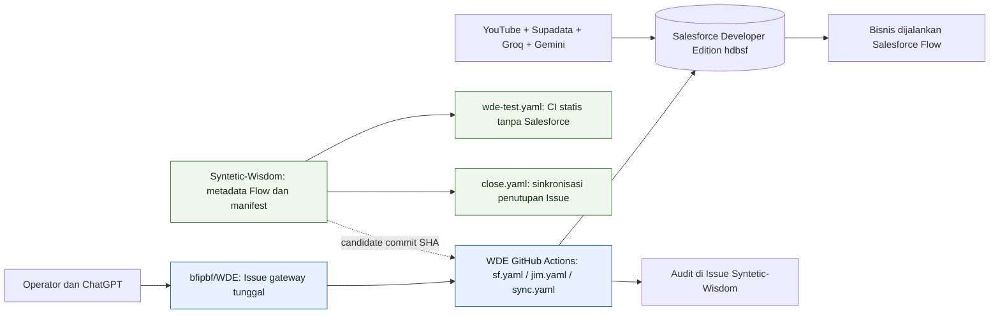

**Batas repo:** `jimmytobing/Syntetic-Wisdom` hanya memiliki dua YAML: `close.yaml` dan `wde-test.yaml`. `sf.yaml`, `jim.yaml`, dan `sync.yaml` berada di `bfipbf/WDE`; **bukan** workflow aktif di repo source. Runtime konten: `WDE_Discover_Weekly_Sermon`, `WDE_Persist_Raw_Transcript`, dan `WDE_Orchestrate_Stage_A/B/C`.

## 02 · Pemisahan tanggung jawab dan daftar Flow utama

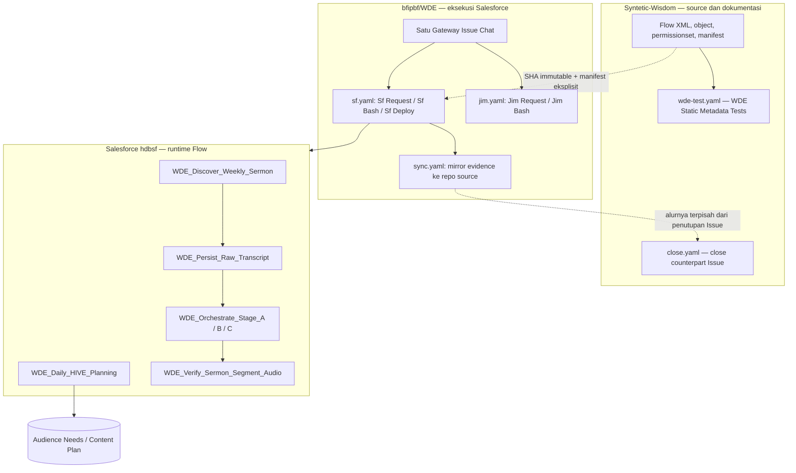

**Flow inti di source:** `WDE_Discover_Weekly_Sermon`, `WDE_Orchestrator_Weekly_Sermon`, `WDE_Persist_Raw_Transcript`, `WDE_Orchestrate_Stage_A`, `WDE_Orchestrate_Stage_B`, `WDE_Orchestrate_Stage_C`, `WDE_Daily_HIVE_Planning`, dan `WDE_Verify_Sermon_Segment_Audio`. Keberadaan metadata tidak memastikan status aktif pada Org.

## 03 · Discovery khotbah mingguan

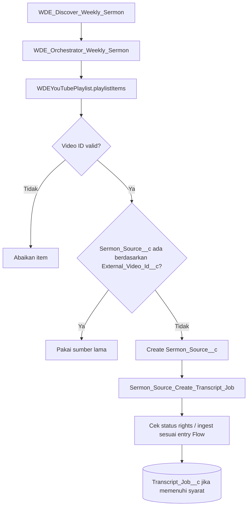

**Nama Flow:** `WDE_Discover_Weekly_Sermon` memanggil `WDE_Orchestrator_Weekly_Sermon`; `Sermon_Source_Create_Transcript_Job` adalah trigger terpisah pada sumber. Video baru tidak otomatis mendapatkan izin penggunaan ulang.

## 04 · Transcript, caption, dan awal segmentasi

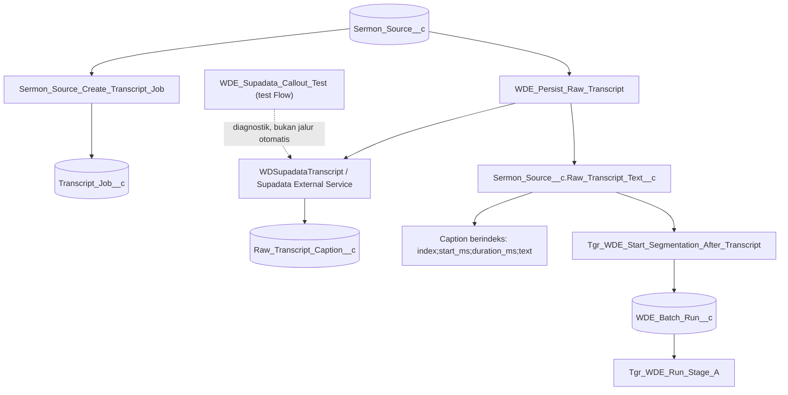

**Nama Flow:** `Sermon_Source_Create_Transcript_Job`, `WDE_Persist_Raw_Transcript`, `Tgr_WDE_Start_Segmentation_After_Transcript`, `Tgr_WDE_Run_Stage_A`, serta `WDE_Supadata_Callout_Test` (uji). Caption dan source harus diverifikasi sebelum dianggap lengkap.

## 05 · Stage A, B, dan C dengan nama Flow eksplisit

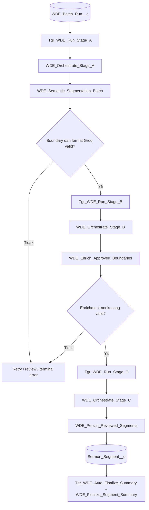

**Flow A:** `Tgr_WDE_Run_Stage_A` → `WDE_Orchestrate_Stage_A` → `WDE_Semantic_Segmentation_Batch`. **Flow B:** `Tgr_WDE_Run_Stage_B` → `WDE_Orchestrate_Stage_B` → `WDE_Enrich_Approved_Boundaries`. **Flow C:** `Tgr_WDE_Run_Stage_C` → `WDE_Orchestrate_Stage_C` → `WDE_Persist_Reviewed_Segments`. **Summary:** `Tgr_WDE_Auto_Finalize_Summary` → `WDE_Finalize_Segment_Summary`.

## 06 · Retry, checkpoint, dan perbaikan batch

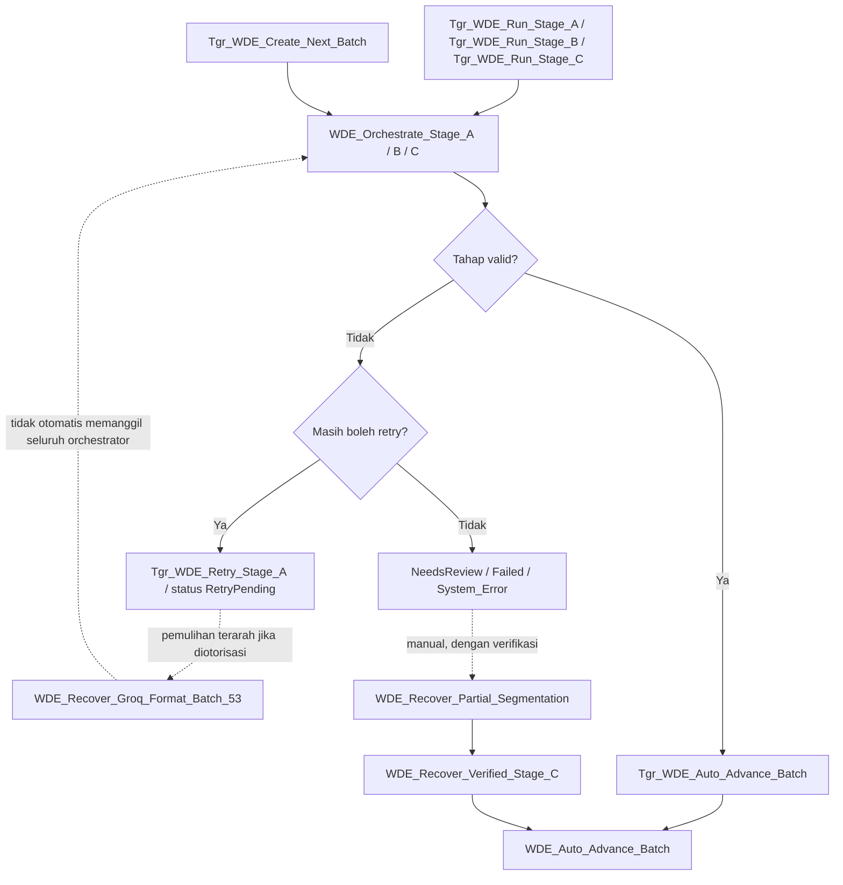

**Nama Flow:** `Tgr_WDE_Retry_Stage_A`, `WDE_Recover_Groq_Format_Batch_53`, `WDE_Recover_Partial_Segmentation`, `WDE_Recover_Verified_Stage_C`, `Tgr_WDE_Auto_Advance_Batch`, `WDE_Auto_Advance_Batch`, dan `Tgr_WDE_Create_Next_Batch`. Panah pemulihan bersifat ilustrasi opsi terkontrol, **bukan** bukti semua Flow saling memanggil secara langsung.

## 07 · QA audio selektif dan status source

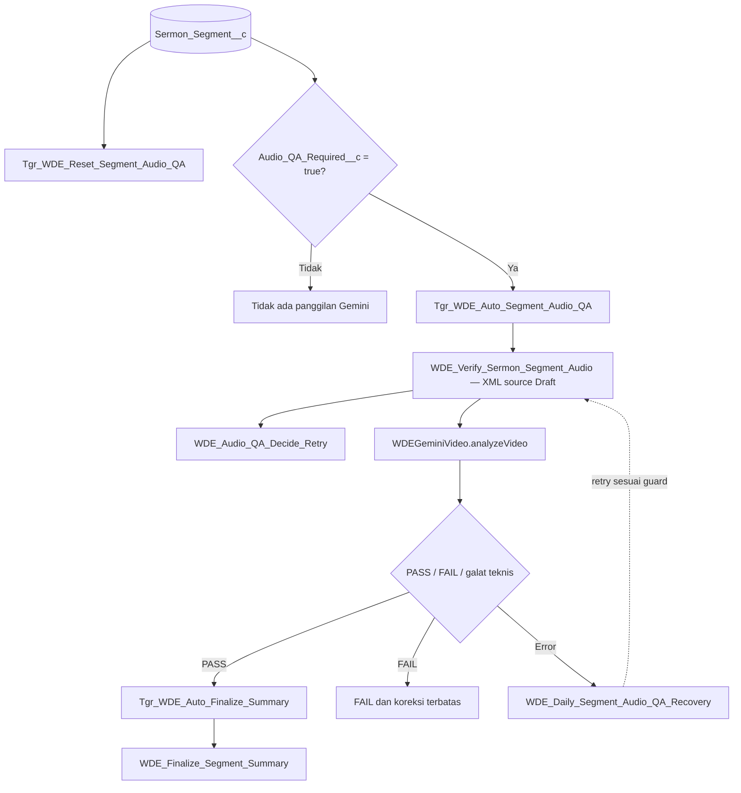

**Nama Flow:** `Tgr_WDE_Reset_Segment_Audio_QA`, `Tgr_WDE_Auto_Segment_Audio_QA`, `WDE_Verify_Sermon_Segment_Audio`, `WDE_Audio_QA_Decide_Retry`, `WDE_Daily_Segment_Audio_QA_Recovery`, `Tgr_WDE_Auto_Finalize_Summary`, dan `WDE_Finalize_Segment_Summary`. **Perhatian:** XML `WDE_Verify_Sermon_Segment_Audio` saat snapshot adalah **Draft**. Bukti eksekusi historis tidak membuktikan versi source terbaru aktif.

## 08 · Status QA dan Flow pemulihan

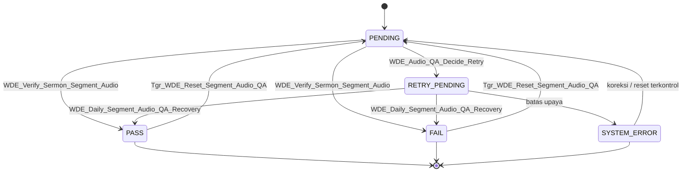

**Nama Flow keputusan:** `WDE_Verify_Sermon_Segment_Audio` dan `WDE_Audio_QA_Decide_Retry`. **Pemulihan:** `WDE_Daily_Segment_Audio_QA_Recovery`. **Reset:** `Tgr_WDE_Reset_Segment_Audio_QA`. Transisi adalah *model status*, bukan jaminan jalur otomatis aktif pada Org. `SYSTEM_ERROR` **bukan** `PASS`.

## 09 · Fondasi Audio QA foreground (semua Draft)

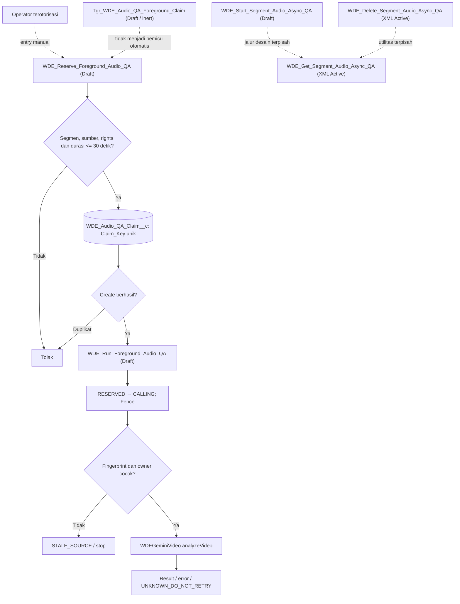

**Nama Flow foreground:** `Tgr_WDE_Audio_QA_Foreground_Claim` (XML Draft), `WDE_Reserve_Foreground_Audio_QA` (XML Draft), `WDE_Run_Foreground_Audio_QA` (XML Draft). **Flow asynchronous pada source:** `WDE_Start_Segment_Audio_Async_QA` (XML Draft), `WDE_Get_Segment_Audio_Async_QA` (XML Active), dan `WDE_Delete_Segment_Audio_Async_QA` (XML Active). Garis putus-putus menunjukkan kelompok rancangan terpisah; aktivasi, runner permission, dan deduplikasi provider absolut masih **UNVERIFIED**.

## 10 · Analisis Gemini sumber, bukan verifikasi audio segmen

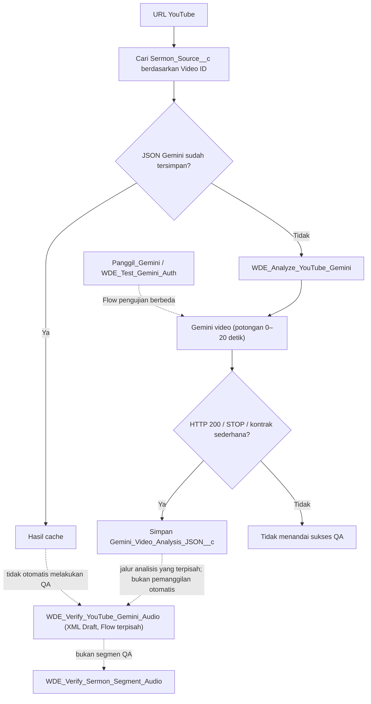

**Nama Flow:** `WDE_Analyze_YouTube_Gemini`, `WDE_Verify_YouTube_Gemini_Audio`, `WDE_Verify_Sermon_Segment_Audio`, `Panggil_Gemini`, dan `WDE_Test_Gemini_Auth`. Hasil respons dan cache tidak otomatis membuktikan akurasi audio, semantik, kutipan, atau hak cipta.

## 11 · Pengetahuan, konsep, insight dan review

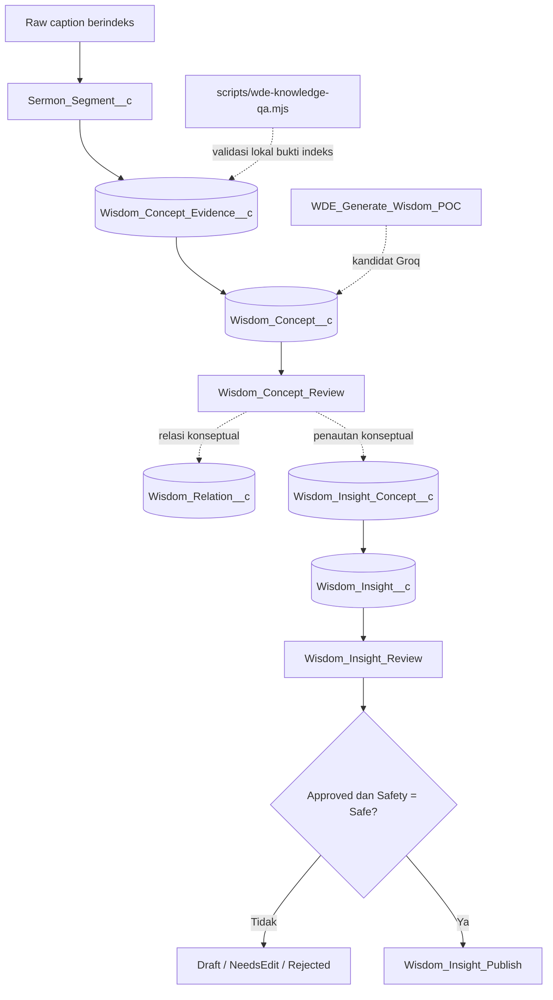

**Nama Flow:** `WDE_Generate_Wisdom_POC`, `Wisdom_Concept_Review`, `Wisdom_Insight_Review`, `Wisdom_Insight_Publish`. Flow review tetap berbeda dari test `scripts/wde-knowledge-qa.mjs`; otomasi tidak boleh menggantikan persetujuan editorial.

## 12 · Audience Intelligence dari komentar nyata

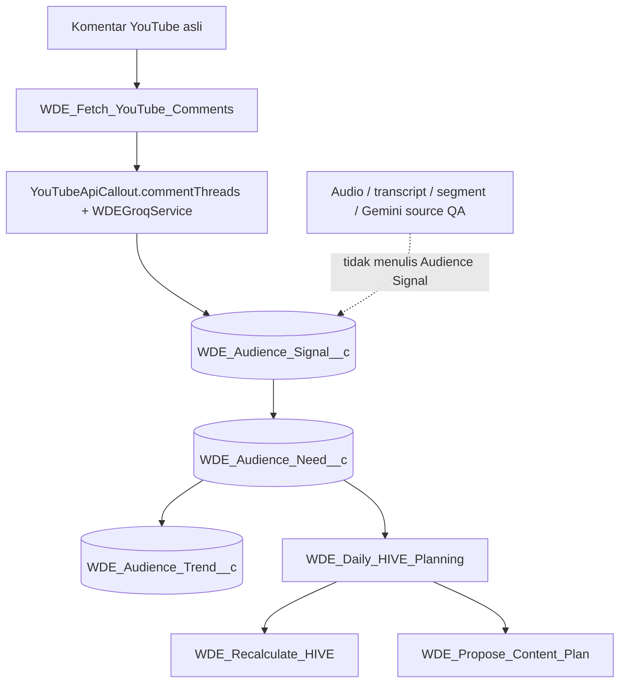

**Nama Flow:** `WDE_Fetch_YouTube_Comments`, `WDE_Daily_HIVE_Planning`, `WDE_Recalculate_HIVE`, dan `WDE_Propose_Content_Plan`. HIVE bersumber pada sinyal komentar, bukan dari isi khotbah atau verdict Audio QA.

## 13 · Perhitungan HIVE dari evidence

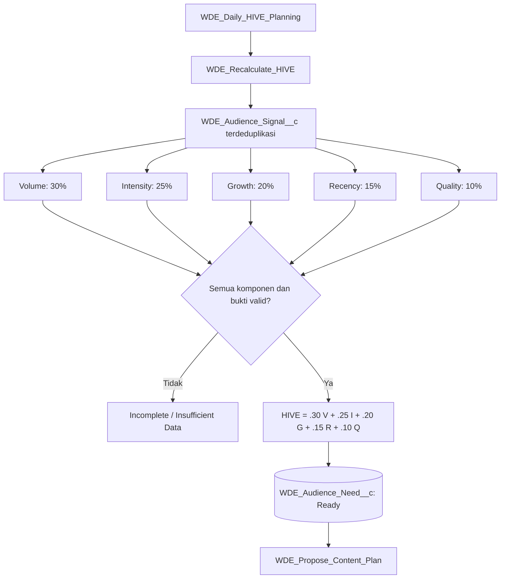

**Nama Flow:** `WDE_Daily_HIVE_Planning` adalah scheduler/orchestrator; `WDE_Recalculate_HIVE` menghitung komponen, kemudian `WDE_Propose_Content_Plan` menguji kelayakan perencanaan. Nilai tanpa bukti tidak boleh dianggap skor yang valid.

## 14 · Content Plan, threshold, dan review

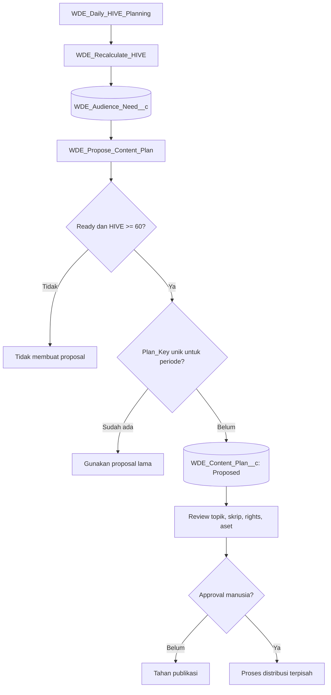

**Nama Flow:** `WDE_Daily_HIVE_Planning`, `WDE_Recalculate_HIVE`, `WDE_Propose_Content_Plan`. Flow ini mengusulkan rancangan, **bukan** menerbitkan video secara otomatis.

## 15 · Model data operasional

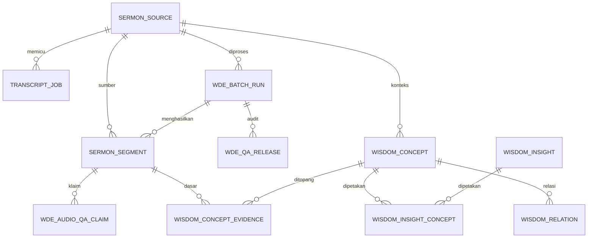

_Nama entitas disederhanakan dari API `__c`; relasi menunjukkan keterkaitan konseptual, bukan seluruh lookup fisik yang diverifikasi._

## 16 · Model data audiens dan perencanaan

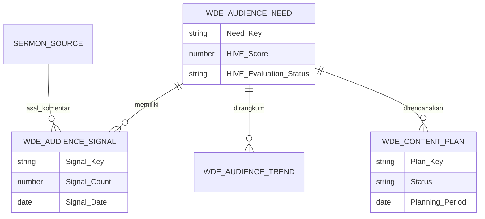

_External key dipakai untuk deduplikasi dan pelacakan sumber._

## 17 · Kredensial External Service dan Flow pemakai

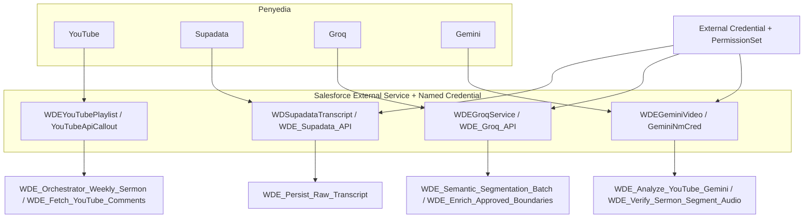

**Flow pemakai:** `WDE_Orchestrator_Weekly_Sermon`, `WDE_Fetch_YouTube_Comments`, `WDE_Persist_Raw_Transcript`, `WDE_Semantic_Segmentation_Batch`, `WDE_Enrich_Approved_Boundaries`, `WDE_Analyze_YouTube_Gemini`, dan `WDE_Verify_Sermon_Segment_Audio`. Credential dan principal harus dikonfigurasi aman; tidak ada kredensial yang diekspos dalam SADD.

## 18 · Gateway Salesforce hanya di bfipbf/WDE

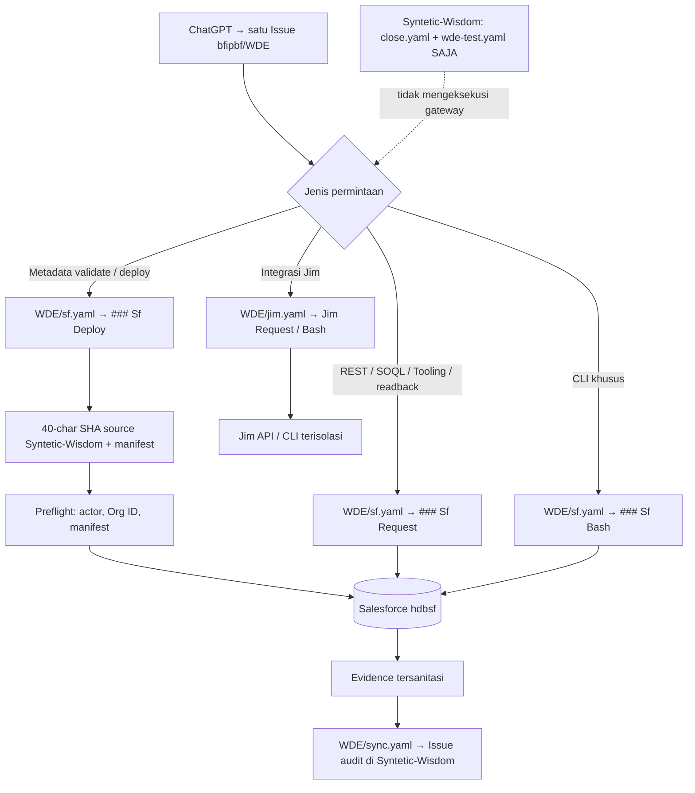

**Bukan lagi berada di repo source:** `.github/workflows/sf.yaml`, `.github/workflows/jim.yaml`, `.github/workflows/salesforce-rca-ci.yml` dan executor `.github/mjs/sf-*.mjs` / `jim-*.mjs` yang telah dipensiunkan. Jalur Salesforce berada di `bfipbf/WDE`; tidak ada keterkaitan langsung dengan runtime Flow `WDE_Orchestrate_Stage_A/B/C` kecuali deployment atau API eksplisit.

## 19 · Jejak audit berbasis gateway dan mirror

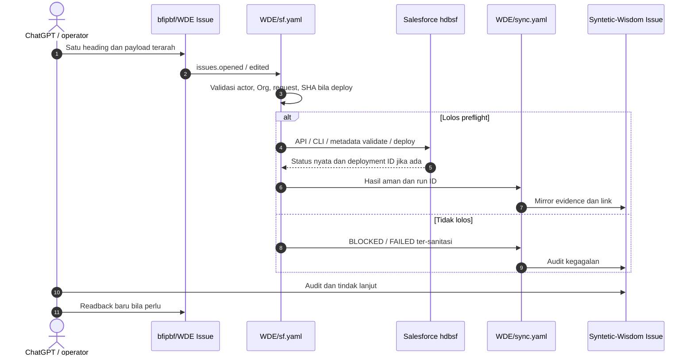

**Sumber eksekusi:** `bfipbf/WDE/.github/workflows/sf.yaml` dan `sync.yaml`, bukan YAML yang dihapus dari `Syntetic-Wisdom`. **Penutupan Issue:** `close.yaml` dipertahankan di kedua repository. `Actions success` tidak menggantikan bukti hasil Salesforce atau readback.

## 20 · Pengujian statis pasca-penghapusan YAML

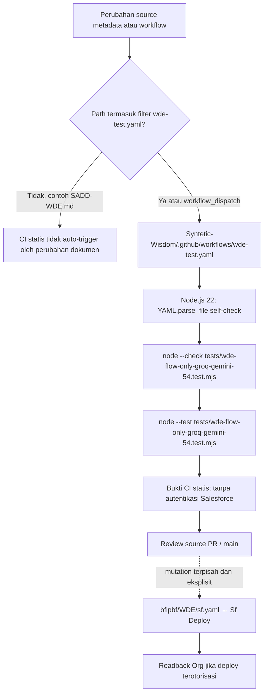

**Workflow lokal yang aktif untuk CI:** `.github/workflows/wde-test.yaml`, job `wde-static`. Pengujian memeriksa kontrak metadata Groq, Gemini, dan Audio QA secara **offline**; tidak menjalankan Flow pada Salesforce. `SADD-WDE.md` tidak termasuk path trigger otomatis. Flow terkait uji: `WDE_Semantic_Segmentation_Batch`, `WDE_Enrich_Approved_Boundaries`, dan `WDE_Verify_Sermon_Segment_Audio`.

## 21 · Evolusi implementasi sampai pembersihan YAML

```mermaid
flowchart LR
  MOCK["PoC #1–#8: RCA mock / read-only"] --> GW["Gateway Sf Request / Bash / Deploy"]
  GW --> HIVE["PR #36: HIVE dan Content Plan"]
  HIVE --> QA["PR #52: segmentasi, Gemini QA"]
  QA --> HIST["PR #62: ditutup tanpa merge"]
  HIST --> F70["PR #70: fondasi QA Draft, merged"]
  F70 --> F68["PR #68: 18 metadata Org disimpan, merged"]
  F68 --> ISSUE["PR #73–#74: mirror close, merged"]
  ISSUE --> CI["PR #77: wde-Test.yaml, merged"]
  CI --> CLEAN["PR #78: dua YAML tersisa; wde-test.yaml, merged"]
  CLEAN --> MAIN["main 44d66f267545: source-only + CI statis"]
  classDef good fill:#e7f7eb,stroke:#238043,color:#14361f;
  classDef old fill:#ffecec,stroke:#b42318,color:#411;
  class HIVE,QA,F70,F68,ISSUE,CI,CLEAN,MAIN good;
  class HIST old;
```

**Flow terkait evolusi:** `WDE_Recalculate_HIVE`, `WDE_Propose_Content_Plan`, `WDE_Orchestrate_Stage_A/B/C`, `WDE_Verify_Sermon_Segment_Audio`, dan `WDE_Reserve_Foreground_Audio_QA`. PR #77 dan #78 memindahkan/meniadakan eksekusi gateway di repo source **tanpa deployment Salesforce**.

## 22 · Status bukti dan risiko yang harus dipisah

```mermaid
flowchart TB
  S["Source tersimpan di main"] --> Q{"Apa yang sudah dibuktikan?"}
  Q --> A["CI dan XML valid"]
  Q --> B["Metadata validate checkOnly"]
  Q --> C["Metadata ter-deploy"]
  Q --> D["Flow aktif di Org"]
  Q --> E["Runtime dan kualitas hasil teruji"]
  A -. "bukan bukti" .-> C
  B -. "bukan bukti" .-> C
  C -. "bukan bukti" .-> D
  D -. "bukan bukti" .-> E
  E --> PASS["PASS hanya dengan bukti kualitas sesuai scope"]
  G["QA foreground PR #70"] --> STATUS["Source merged; Draft, activation / exactly-once UNVERIFIED"]
  H["Snapshot PR #68"] --> STAT2["18 metadata dari Org; full parity UNVERIFIED"]
  classDef warn fill:#fff1e8,stroke:#b8651b,color:#44210d;
  class STATUS,STAT2 warn;
```

_Pemisahan status mencegah klaim keliru tentang aktivasi, QA, dan kesetaraan Org–Git._

## 23 · Struktur repo source saat ini: dua YAML

```mermaid
flowchart TD
  R["Syntetic-Wisdom / main"] --> W[".github/workflows"]
  W --> CLOSE["close.yaml: sinkronisasi penutupan issue"]
  W --> TEST["wde-test.yaml: CI statis metadata"]
  R --> FORCE["force-app/main/default"]
  FORCE --> FLOWS["57 *.flow-meta.xml"]
  FORCE --> OBJ["CustomObject + field Salesforce"]
  FORCE --> CONN["Named / External Credential dan External Service"]
  FORCE --> PERM["PermissionSet"]
  R --> MAN["manifest/*.xml — scope deploy"]
  R --> SCRIPTS["scripts/*.mjs — alat QA lokal yang tersisa"]
  R --> TESTS["tests/*.test.mjs — regresi / statis"]
  R --> DOCS["docs + SADD-WDE.md"]
  R --> SOURCE["ai-source"]
  OLD["sf.yaml / jim.yaml / salesforce-rca-ci.yml / gw-unit-test.yaml"] -. "DIHAPUS dari repo source" .-> W
  GATE["bfipbf/WDE: sf.yaml, jim.yaml, sync.yaml, close.yaml"] -. "gateway berada di repo berbeda" .-> R
  classDef gone fill:#f6e5e5,stroke:#a33,color:#411;
  class OLD gone;
```

**Inventaris aktual main setelah PR #78:** tepat **2 YAML/YML**, yaitu `close.yaml` dan `wde-test.yaml`; tetap ada **57 file Flow XML**. `gw-unit-test.yaml` lebih dulu diganti PR #77, lalu `wde-Test.yaml` menjadi `wde-test.yaml` pada PR #78. Test gateway lama dan modul `sf-*` / `jim-*` privat juga dihapus. Tidak ada perubahan Salesforce akibat cleanup.

## 24 · Safety gate, verifikasi Flow, dan retry

```mermaid
flowchart TD
  SOURCE["Source XML Flow ada?"] --> STATUS["Periksa status XML: Active atau Draft"]
  STATUS --> LIVE{"Akan mengubah Salesforce?"}
  LIVE -- "Tidak" --> GIT["Review diff, dokumentasi, CI statis bila dipicu"]
  LIVE -- "Ya" --> AUTH["Otorisasi eksplisit dan target Org hdbsf"]
  AUTH --> PRE["Readback status/versi Flow dan data awal"]
  PRE --> SHA["Commit SHA 40 karakter + manifest eksplisit"]
  SHA --> DEP["bfipbf/WDE/sf.yaml → Sf Deploy"]
  DEP --> OUT{"Hasil dan deployment ID jelas?"}
  OUT -- "Ya" --> POST["Readback metadata dan audit"]
  OUT -- "Timeout atau ambigu" --> HALT["STOP; periksa efek sebelumnya sebelum retry"]
  POST --> QA["Uji runtime terarah jika diotorisasi"]
  QA --> DONE["Catat PASS / FAIL / UNVERIFIED sesuai bukti"]
```

**Contoh Flow wajib diperlakukan sesuai status source dan bukti Org:** `WDE_Verify_Sermon_Segment_Audio` (XML `Draft`), `WDE_Reserve_Foreground_Audio_QA` (`Draft`), `WDE_Run_Foreground_Audio_QA` (`Draft`), serta `WDE_Orchestrate_Stage_A` (XML `Active`). Source Git dan aktivasi Org adalah dua bukti berbeda.

## 25 · Inventaris Flow: sumber dan pengetahuan

```mermaid
flowchart LR
  ROOT["Inventaris Flow: sumber dan pengetahuan"]
  F0["Panggil_Gemini"]
  F1["Sermon_Source_Create_Transcript_Job"]
  F2["Tgr_Sample"]
  F3["WDE_Discover_Weekly_Sermon"]
  F4["WDE_Orchestrator_Weekly_Sermon"]
  F5["WDE_Persist_Raw_Transcript"]
  F6["WDE_Supadata_Callout_Test"]
  F7["WDE_Analyze_YouTube_Gemini"]
  F8["WDE_Fetch_YouTube_Comments"]
  F9["WDE_Generate_Wisdom_POC"]
  F10["Wisdom_Concept_Review"]
  F11["Wisdom_Insight_Review"]
  F12["Wisdom_Insight_Publish"]
  ROOT --- F0
  ROOT --- F1
  ROOT --- F2
  ROOT --- F3
  ROOT --- F4
  ROOT --- F5
  ROOT --- F6
  ROOT --- F7
  ROOT --- F8
  ROOT --- F9
  ROOT --- F10
  ROOT --- F11
  ROOT --- F12
```

**Daftar nama API Flow (13):** `Panggil_Gemini` · `Sermon_Source_Create_Transcript_Job` · `Tgr_Sample` · `WDE_Discover_Weekly_Sermon` · `WDE_Orchestrator_Weekly_Sermon` · `WDE_Persist_Raw_Transcript` · `WDE_Supadata_Callout_Test` · `WDE_Analyze_YouTube_Gemini` · `WDE_Fetch_YouTube_Comments` · `WDE_Generate_Wisdom_POC` · `Wisdom_Concept_Review` · `Wisdom_Insight_Review` · `Wisdom_Insight_Publish`.

**Catatan:** ini indeks semua Flow yang ada sebagai XML di `main`, termasuk Flow eksperimen, historis, Draft, dan trigger. Status runtime Salesforce harus diperiksa tersendiri.

## 26 · Inventaris Flow: orchestrator dan batch

```mermaid
flowchart LR
  ROOT["Inventaris Flow: orchestrator dan batch"]
  F0["Tgr_WDE_Auto_Advance_Batch"]
  F1["Tgr_WDE_Create_Next_Batch"]
  F2["Tgr_WDE_Retry_Stage_A"]
  F3["Tgr_WDE_Run_Stage_A"]
  F4["Tgr_WDE_Run_Stage_B"]
  F5["Tgr_WDE_Run_Stage_C"]
  F6["Tgr_WDE_Start_Segmentation_After_Transcript"]
  F7["WDE_Auto_Advance_Batch"]
  F8["WDE_Enrich_Approved_Boundaries"]
  F9["WDE_Orchestrate_Stage_A"]
  F10["WDE_Orchestrate_Stage_B"]
  F11["WDE_Orchestrate_Stage_C"]
  F12["WDE_Persist_Reviewed_Segments"]
  F13["WDE_Recover_Groq_Format_Batch_53"]
  F14["WDE_Recover_Partial_Segmentation"]
  F15["WDE_Recover_Verified_Stage_C"]
  F16["WDE_Semantic_Review_Batch"]
  F17["WDE_Semantic_Review_Batch_v2"]
  F18["WDE_Semantic_Segmentation_Batch"]
  F19["WDE_Semantic_Segmentation_POC"]
  ROOT --- F0
  ROOT --- F1
  ROOT --- F2
  ROOT --- F3
  ROOT --- F4
  ROOT --- F5
  ROOT --- F6
  ROOT --- F7
  ROOT --- F8
  ROOT --- F9
  ROOT --- F10
  ROOT --- F11
  ROOT --- F12
  ROOT --- F13
  ROOT --- F14
  ROOT --- F15
  ROOT --- F16
  ROOT --- F17
  ROOT --- F18
  ROOT --- F19
```

**Daftar nama API Flow (20):** `Tgr_WDE_Auto_Advance_Batch` · `Tgr_WDE_Create_Next_Batch` · `Tgr_WDE_Retry_Stage_A` · `Tgr_WDE_Run_Stage_A` · `Tgr_WDE_Run_Stage_B` · `Tgr_WDE_Run_Stage_C` · `Tgr_WDE_Start_Segmentation_After_Transcript` · `WDE_Auto_Advance_Batch` · `WDE_Enrich_Approved_Boundaries` · `WDE_Orchestrate_Stage_A` · `WDE_Orchestrate_Stage_B` · `WDE_Orchestrate_Stage_C` · `WDE_Persist_Reviewed_Segments` · `WDE_Recover_Groq_Format_Batch_53` · `WDE_Recover_Partial_Segmentation` · `WDE_Recover_Verified_Stage_C` · `WDE_Semantic_Review_Batch` · `WDE_Semantic_Review_Batch_v2` · `WDE_Semantic_Segmentation_Batch` · `WDE_Semantic_Segmentation_POC`.

**Catatan:** ini indeks semua Flow yang ada sebagai XML di `main`, termasuk Flow eksperimen, historis, Draft, dan trigger. Status runtime Salesforce harus diperiksa tersendiri.

## 27 · Inventaris Flow: audio dan quality gate

```mermaid
flowchart LR
  ROOT["Inventaris Flow: audio dan quality gate"]
  F0["Tgr_WDE_Audio_QA_Foreground_Claim"]
  F1["Tgr_WDE_Auto_Finalize_Summary"]
  F2["Tgr_WDE_Auto_Segment_Audio_QA"]
  F3["Tgr_WDE_Reset_Segment_Audio_QA"]
  F4["WDE_Audio_QA_Decide_Retry"]
  F5["WDE_Daily_Segment_Audio_QA_Recovery"]
  F6["WDE_Delete_Segment_Audio_Async_QA"]
  F7["WDE_Finalize_Segment_Summary"]
  F8["WDE_Get_Editorial_Audio_Context"]
  F9["WDE_Get_Segment_Audio_Async_QA"]
  F10["WDE_QA_OAuth_Commit_Release"]
  F11["WDE_Reserve_Foreground_Audio_QA"]
  F12["WDE_Run_Foreground_Audio_QA"]
  F13["WDE_Start_Segment_Audio_Async_QA"]
  F14["WDE_Verify_Isolated_Test5_Segment"]
  F15["WDE_Verify_Sermon_Segment_Audio"]
  F16["WDE_Verify_YouTube_Gemini_Audio"]
  ROOT --- F0
  ROOT --- F1
  ROOT --- F2
  ROOT --- F3
  ROOT --- F4
  ROOT --- F5
  ROOT --- F6
  ROOT --- F7
  ROOT --- F8
  ROOT --- F9
  ROOT --- F10
  ROOT --- F11
  ROOT --- F12
  ROOT --- F13
  ROOT --- F14
  ROOT --- F15
  ROOT --- F16
```

**Daftar nama API Flow (17):** `Tgr_WDE_Audio_QA_Foreground_Claim` · `Tgr_WDE_Auto_Finalize_Summary` · `Tgr_WDE_Auto_Segment_Audio_QA` · `Tgr_WDE_Reset_Segment_Audio_QA` · `WDE_Audio_QA_Decide_Retry` · `WDE_Daily_Segment_Audio_QA_Recovery` · `WDE_Delete_Segment_Audio_Async_QA` · `WDE_Finalize_Segment_Summary` · `WDE_Get_Editorial_Audio_Context` · `WDE_Get_Segment_Audio_Async_QA` · `WDE_QA_OAuth_Commit_Release` · `WDE_Reserve_Foreground_Audio_QA` · `WDE_Run_Foreground_Audio_QA` · `WDE_Start_Segment_Audio_Async_QA` · `WDE_Verify_Isolated_Test5_Segment` · `WDE_Verify_Sermon_Segment_Audio` · `WDE_Verify_YouTube_Gemini_Audio`.

**Catatan:** ini indeks semua Flow yang ada sebagai XML di `main`, termasuk Flow eksperimen, historis, Draft, dan trigger. Status runtime Salesforce harus diperiksa tersendiri.

## 28 · Inventaris Flow: audiens dan eksperimen

```mermaid
flowchart LR
  ROOT["Inventaris Flow: audiens dan eksperimen"]
  F0["WDE_Daily_HIVE_Planning"]
  F1["WDE_Propose_Content_Plan"]
  F2["WDE_Recalculate_HIVE"]
  F3["WDE_Test_Audience_Context_AB"]
  F4["WDE_Test_Audio_QA_Recovery"]
  F5["WDE_Test_Gemini_Async_Text"]
  F6["WDE_Test_Gemini_Auth"]
  ROOT --- F0
  ROOT --- F1
  ROOT --- F2
  ROOT --- F3
  ROOT --- F4
  ROOT --- F5
  ROOT --- F6
```

**Daftar nama API Flow (7):** `WDE_Daily_HIVE_Planning` · `WDE_Propose_Content_Plan` · `WDE_Recalculate_HIVE` · `WDE_Test_Audience_Context_AB` · `WDE_Test_Audio_QA_Recovery` · `WDE_Test_Gemini_Async_Text` · `WDE_Test_Gemini_Auth`.

**Catatan:** ini indeks semua Flow yang ada sebagai XML di `main`, termasuk Flow eksperimen, historis, Draft, dan trigger. Status runtime Salesforce harus diperiksa tersendiri.

## Bukti utama

[Gateway Chat #21](https://github.com/bfipbf/WDE/issues/21) · [PR #77](https://github.com/jimmytobing/Syntetic-Wisdom/pull/77) · [PR #78](https://github.com/jimmytobing/Syntetic-Wisdom/pull/78) · [main setelah cleanup](https://github.com/jimmytobing/Syntetic-Wisdom/commit/44d66f2675456d1ed203c526f30b4ea631038b79) · [wde-test.yaml](.github/workflows/wde-test.yaml) · [close.yaml](.github/workflows/close.yaml) · [PR #52](https://github.com/jimmytobing/Syntetic-Wisdom/pull/52) · [PR #70](https://github.com/jimmytobing/Syntetic-Wisdom/pull/70) · [PR #68](https://github.com/jimmytobing/Syntetic-Wisdom/pull/68) · [PR #73](https://github.com/jimmytobing/Syntetic-Wisdom/pull/73) · [PR #74](https://github.com/jimmytobing/Syntetic-Wisdom/pull/74) · [Audit metadata](docs/wde-org-git-reconciliation-2026-11-22.md) · [Desain QA Draft](docs/wde-audio-qa-flow-only-70.md) · [HIVE](docs/wde-hive-content-planning.md) · [Gateway deploy](docs/sf-deploy.md).

**Batas bukti:** Full Org–Git equivalence, aktivasi QA foreground, dan keakuratan seluruh segmen audio tetap **UNVERIFIED** kecuali ada bukti tersendiri. Cleanup PR #78 dan perubahan SADD adalah **source-only**; tidak ada operasi/deployment Salesforce yang dipicu oleh revisi dokumen ini.
