# SADD–WDE — Arsitektur dan Riwayat Implementasi Visual

**Wisdom Discovery Engine · Snapshot 25 November 2026 · Salesforce Developer Edition `hdbsf` · Org `00Dfj00000eVCOVEA4`**

> **Format:** diagram Mermaid yang dirender sebagai gambar langsung di GitHub; sekitar 90% penyajian visual dan 10% narasi Bahasa Indonesia. Warna, panah, dan status menunjukkan alur konseptual; keberadaan source tidak sama dengan aktivasi Org.

## Cara membaca

Diagram **aktif/terpasang**, **Draft**, **historis**, dan **belum terverifikasi** sengaja dibedakan. Metadata Git yang di-merge **tidak** otomatis ter-deploy. Jangan menggunakan diagram sebagai izin menjalankan Salesforce mutation.

## 01 · Lanskap sistem

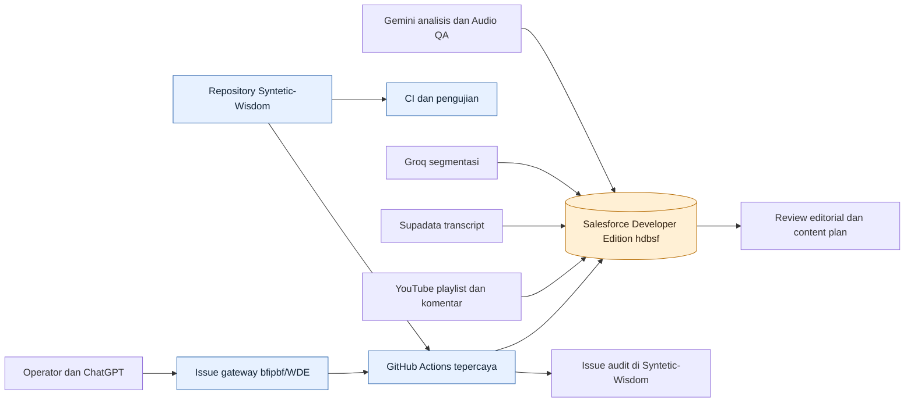

_Batas: GitHub mengelola perubahan dan bukti; pemrosesan bisnis berlangsung di Salesforce Flow._

## 02 · Lapisan tanggung jawab

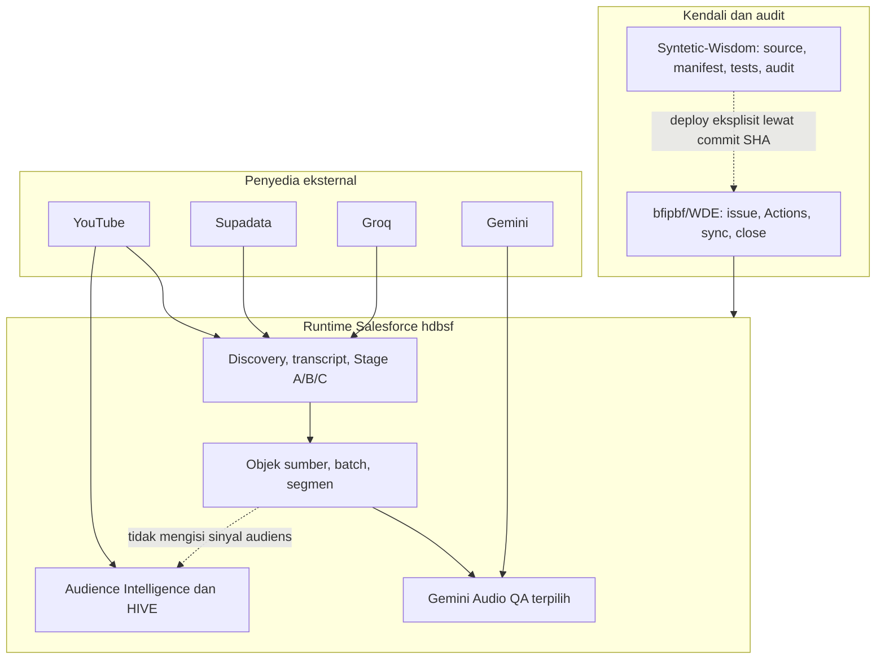

_Panah putus-putus menandai batas kebijakan atau proses yang memerlukan tindakan terpisah._

## 03 · Discovery khotbah mingguan

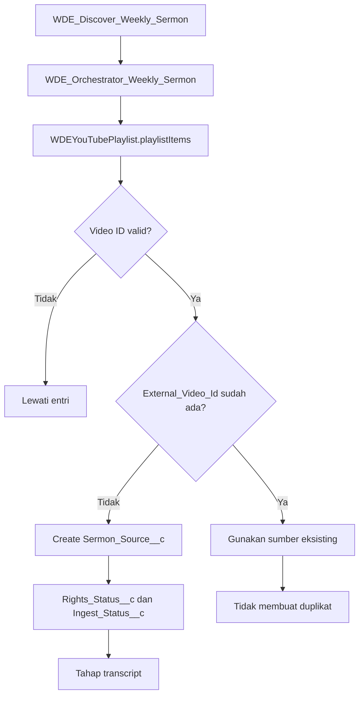

_Video baru tidak otomatis berarti ada izin penggunaan ulang konten._

## 04 · Perolehan dan penyimpanan transcript

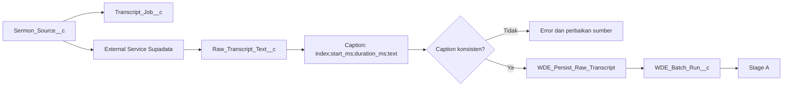

_Caption berindeks dipertahankan agar klaim editorial dapat ditelusuri ke sumber._

## 05 · Mesin segmentasi tiga tahap

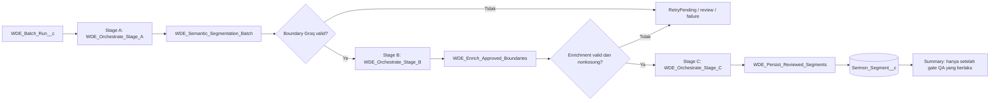

_Setiap tahap memvalidasi kontrak data sebelum melanjutkan; hasil salah tidak dianggap sukses._

## 06 · Batch, retry, dan pemulihan terkendali

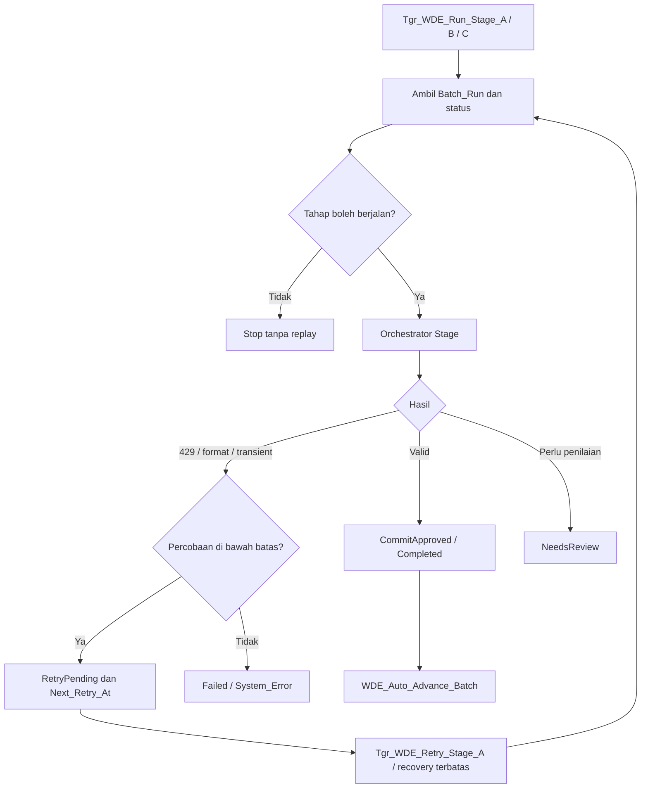

_Retry tidak boleh mengulang mutation yang hasil sebelumnya masih ambigu._

## 07 · QA audio bersyarat per segmen

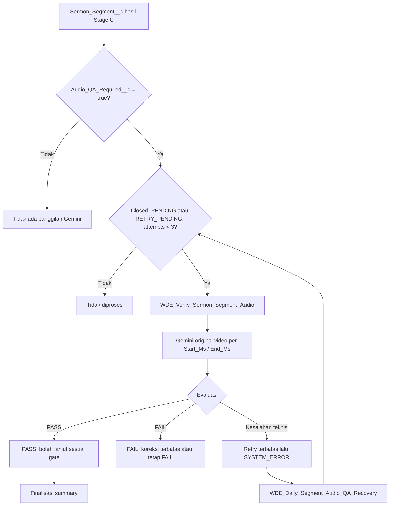

_QA audio bukan sumber Audience Need, HIVE, ataupun izin penggunaan materi._

## 08 · Arti status QA

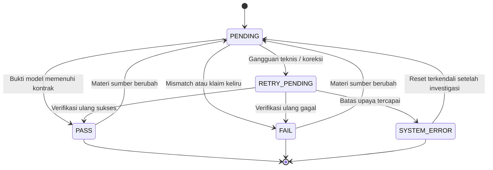

_SYSTEM_ERROR tidak boleh disamakan dengan PASS, termasuk ketika ada pengecualian rilis._

## 09 · Fondasi Audio QA foreground (Draft / tidak aktif)

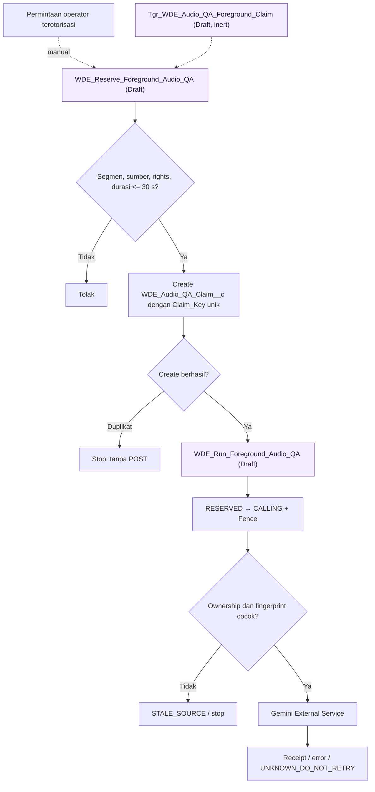

_Fondasi telah masuk main lewat PR #70; aktivasi, assignment runner, dan jaminan exactly-once belum disetujui atau dibuktikan._

## 10 · Gemini analisis sumber ≠ QA segmen

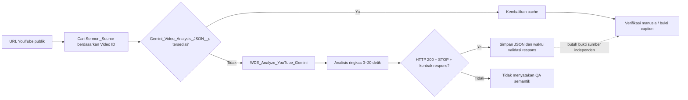

_Timestamp validasi respons tidak membuktikan akurasi audio, kutipan, atau hak cipta._

## 11 · Pengetahuan dan evidence lineage

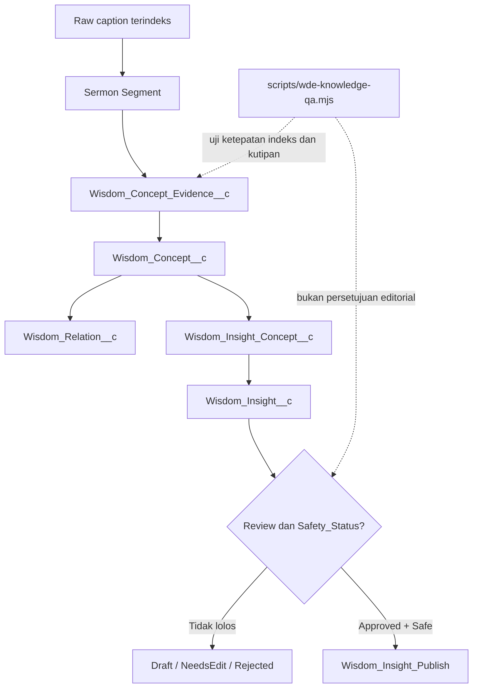

_Sumber bukti dan keputusan manusia tetap dipisahkan dari generasi AI._

## 12 · Audience Intelligence terisolasi dari khotbah

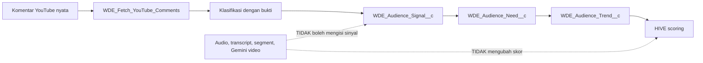

_Peringkat kebutuhan audiens berasal dari komentar; topik khotbah bisa berbeda._

## 13 · HIVE berbasis bukti

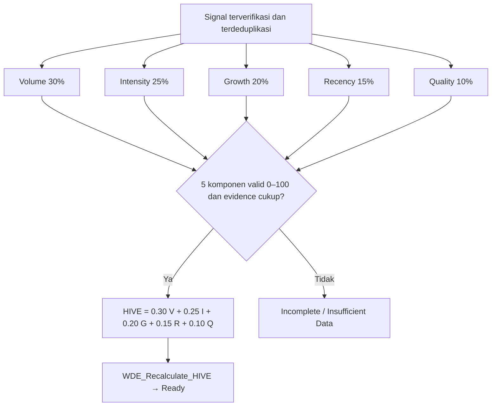

_Nilai tanpa bukti tidak diam-diam ditafsirkan sebagai skor rendah._

## 14 · Content plan dan gerbang publikasi

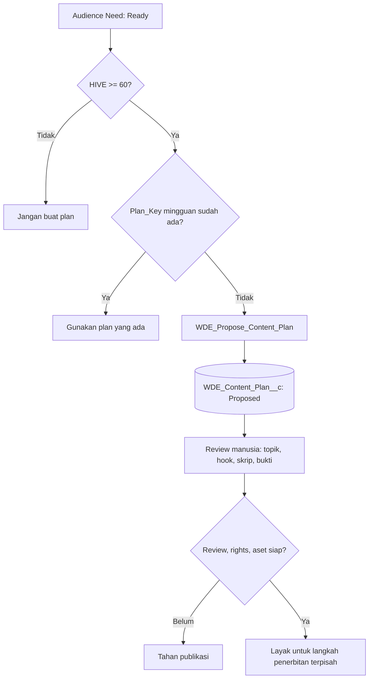

_Flow perencanaan tidak membuat video atau memublikasikan konten secara otomatis._

## 15 · Model data operasional

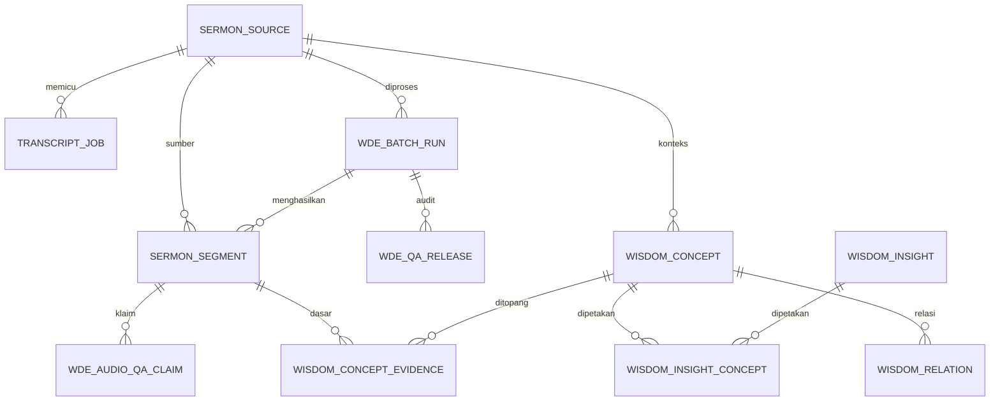

_Nama entitas disederhanakan dari API `__c`; relasi menunjukkan keterkaitan konseptual, bukan seluruh lookup fisik yang diverifikasi._

## 16 · Model data audiens dan perencanaan

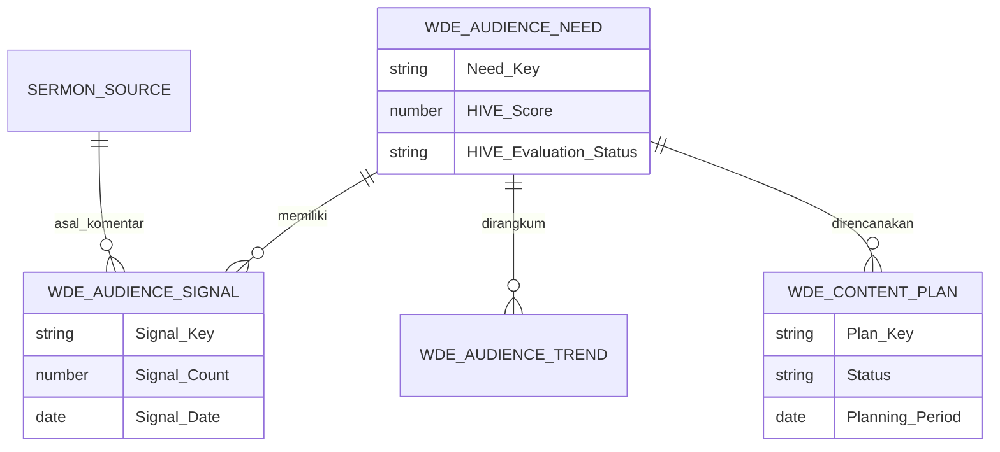

_External key dipakai untuk deduplikasi dan pelacakan sumber._

## 17 · Integrasi dan perimeter kredensial

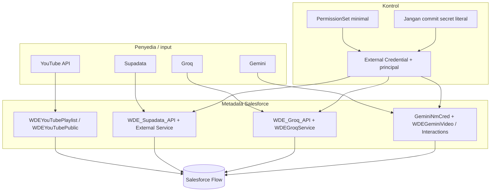

_Secret disimpan di konfigurasi aman; pergantian key historis membutuhkan tindakan tersendiri._

## 18 · Satu Issue Chat, tiga jalur Salesforce

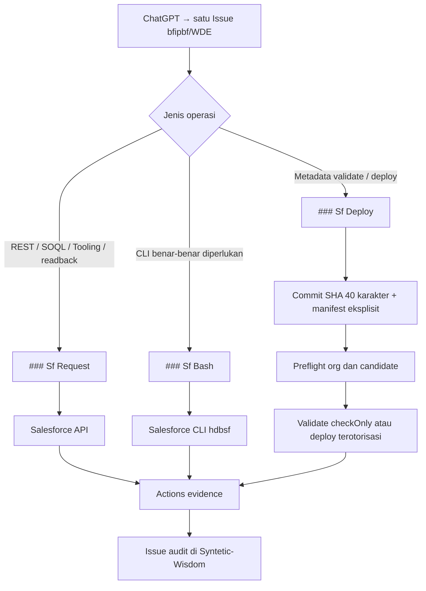

_Mengedit body Issue saat payload deploy aktif dapat memicu ulang Actions; komentar audit tidak boleh dipakai sebagai perintah eksekusi._

## 19 · Jejak audit dari permintaan sampai bukti

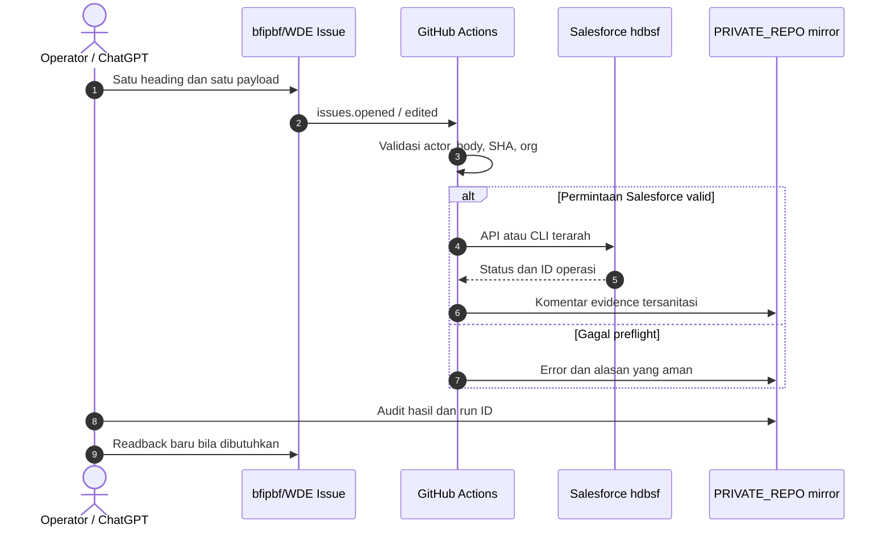

_`Actions success` saja bukan bukti Salesforce berhasil; baca hasil operasi dan readback._

## 20 · Source, pengujian, dan deployment

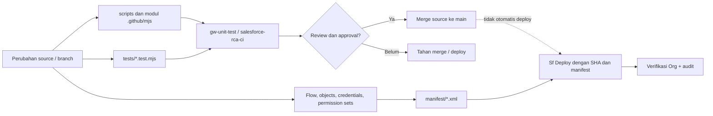

_Merge dokumentasi atau metadata di GitHub tidak mengubah status Salesforce secara otomatis._

## 21 · Evolusi pekerjaan dan PR penting

```mermaid
flowchart LR
  POC["PoC Issues #1–#8: mock dan RCA"] --> API["REST/Tooling, Metadata read"]
  API --> WF["Gateway Sf Request / Bash / Deploy"]
  WF --> HIV["PR #36: HIVE dan content planning"]
  HIV --> SEG["PR #52: segmentasi dan QA bersyarat"]
  SEG --> DRAFT["PR #62: ditutup tanpa merge"]
  DRAFT --> F70["PR #70: fondasi QA Draft, merged"]
  F70 --> F68["PR #68: snapshot 18 metadata Org, merged"]
  F68 --> SYNC["PR #73 / #74: sinkronisasi penutupan Issue, merged"]
  classDef merged fill:#e4f7e8,stroke:#238043,color:#153c1f;
  classDef closed fill:#f7e4e4,stroke:#b42318,color:#411;
  class HIV,SEG,F70,F68,SYNC merged;
  class DRAFT closed;
```

_Snapshot ini mencerminkan pemeriksaan GitHub 25 November 2026, bukan penegasan semua runtime sudah accepted._

## 22 · Status bukti dan risiko yang harus dipisah

```mermaid
flowchart TB
  S["Source tersimpan di main"] --> Q{"Apa yang sudah dibuktikan?"}
  Q --> A["CI dan XML valid"]
  Q --> B["Metadata validate checkOnly"]
  Q --> C["Metadata ter-deploy"]
  Q --> D["Flow aktif di Org"]
  Q --> E["Runtime dan kualitas hasil teruji"]
  A -. "bukan bukti" .-> C
  B -. "bukan bukti" .-> C
  C -. "bukan bukti" .-> D
  D -. "bukan bukti" .-> E
  E --> PASS["PASS hanya dengan bukti kualitas sesuai scope"]
  G["QA foreground PR #70"] --> STATUS["Source merged; Draft, activation / exactly-once UNVERIFIED"]
  H["Snapshot PR #68"] --> STAT2["18 metadata dari Org; full parity UNVERIFIED"]
  classDef warn fill:#fff1e8,stroke:#b8651b,color:#44210d;
  class STATUS,STAT2 warn;
```

_Pemisahan status mencegah klaim keliru tentang aktivasi, QA, dan kesetaraan Org–Git._

## 23 · Peta komponen repository

```mermaid
flowchart TB
  REPO["Syntetic-Wisdom / main"] --> FORCE["force-app/main/default"]
  REPO --> ACTIONS[".github/workflows"]
  REPO --> MOD[".github/mjs"]
  REPO --> MAN["manifest"]
  REPO --> SCRIPT["scripts"]
  REPO --> TEST["tests"]
  REPO --> DOC["docs"]
  REPO --> SAMPLE["ai-source"]
  FORCE --> FLOW["57 Flow XML"]
  FORCE --> OBJ["15 definisi CustomObject XML + field Sermon_Segment"]
  FORCE --> CONNECT["NamedCredential, ExternalCredential, ExternalService"]
  FORCE --> PERM["PermissionSet"]
  ACTIONS --> SF["sf.yaml"]
  ACTIONS --> JIM["jim.yaml"]
  ACTIONS --> CI["gw-unit-test.yaml, salesforce-rca-ci.yml"]
  ACTIONS --> CLOSE["close.yaml"]
  MAN --> PACK["Manifest scoped untuk tiap release"]
```

_Jumlah file adalah inventaris source pada main, bukan jumlah versi atau komponen aktif dalam Org._

## 24 · Keamanan dan pemulihan

```mermaid
flowchart TD
  START["Operasi memiliki efek samping?"] --> CHANGE{"Source-only atau Salesforce mutation?"}
  CHANGE -- "Source-only" --> CHECK["Review PR, tests, tidak ada credential"]
  CHANGE -- "Salesforce mutation" --> AUTH["Persetujuan eksplisit + org hdbsf"]
  AUTH --> PRE["Readback keadaan awal"]
  PRE --> SCOPE["Manifest/record scope terukur"]
  SCOPE --> EXEC["Gateway trusted dengan run ID"]
  EXEC --> OUT{"Hasil pasti?"}
  OUT -- "Ya" --> POST["Readback dan audit"]
  OUT -- "Tidak / timeout" --> HALT["STOP, investigasi efek sebelumnya"]
  HALT -. "tanpa blind retry" .-> PRE
  CHECK --> MERGE["Commit atau merge source"]
```

_Dilarang menganggap kegagalan jaringan berarti mutasi pasti tidak terjadi._

## 25 · Inventaris Flow: sumber dan pengetahuan

```mermaid
flowchart LR
  ROOT["Inventaris Flow: sumber dan pengetahuan"]
  F0["Panggil_Gemini"]
  F1["Sermon_Source_Create_Transcript_Job"]
  F2["Tgr_Sample"]
  F3["WDE_Discover_Weekly_Sermon"]
  F4["WDE_Orchestrator_Weekly_Sermon"]
  F5["WDE_Persist_Raw_Transcript"]
  F6["WDE_Supadata_Callout_Test"]
  F7["WDE_Analyze_YouTube_Gemini"]
  F8["WDE_Fetch_YouTube_Comments"]
  F9["WDE_Generate_Wisdom_POC"]
  F10["Wisdom_Concept_Review"]
  F11["Wisdom_Insight_Review"]
  F12["Wisdom_Insight_Publish"]
  ROOT --- F0
  ROOT --- F1
  ROOT --- F2
  ROOT --- F3
  ROOT --- F4
  ROOT --- F5
  ROOT --- F6
  ROOT --- F7
  ROOT --- F8
  ROOT --- F9
  ROOT --- F10
  ROOT --- F11
  ROOT --- F12
```

_Indeks source; tidak menyiratkan seluruh Flow aktif atau dipanggil oleh jalur produksi._

## 26 · Inventaris Flow: orchestrator dan batch

```mermaid
flowchart LR
  ROOT["Inventaris Flow: orchestrator dan batch"]
  F0["Tgr_WDE_Auto_Advance_Batch"]
  F1["Tgr_WDE_Create_Next_Batch"]
  F2["Tgr_WDE_Retry_Stage_A"]
  F3["Tgr_WDE_Run_Stage_A"]
  F4["Tgr_WDE_Run_Stage_B"]
  F5["Tgr_WDE_Run_Stage_C"]
  F6["Tgr_WDE_Start_Segmentation_After_Transcript"]
  F7["WDE_Auto_Advance_Batch"]
  F8["WDE_Enrich_Approved_Boundaries"]
  F9["WDE_Orchestrate_Stage_A"]
  F10["WDE_Orchestrate_Stage_B"]
  F11["WDE_Orchestrate_Stage_C"]
  F12["WDE_Persist_Reviewed_Segments"]
  F13["WDE_Recover_Groq_Format_Batch_53"]
  F14["WDE_Recover_Partial_Segmentation"]
  F15["WDE_Recover_Verified_Stage_C"]
  F16["WDE_Semantic_Review_Batch"]
  F17["WDE_Semantic_Review_Batch_v2"]
  F18["WDE_Semantic_Segmentation_Batch"]
  F19["WDE_Semantic_Segmentation_POC"]
  ROOT --- F0
  ROOT --- F1
  ROOT --- F2
  ROOT --- F3
  ROOT --- F4
  ROOT --- F5
  ROOT --- F6
  ROOT --- F7
  ROOT --- F8
  ROOT --- F9
  ROOT --- F10
  ROOT --- F11
  ROOT --- F12
  ROOT --- F13
  ROOT --- F14
  ROOT --- F15
  ROOT --- F16
  ROOT --- F17
  ROOT --- F18
  ROOT --- F19
```

_Indeks source; tidak menyiratkan seluruh Flow aktif atau dipanggil oleh jalur produksi._

## 27 · Inventaris Flow: audio dan quality gate

```mermaid
flowchart LR
  ROOT["Inventaris Flow: audio dan quality gate"]
  F0["Tgr_WDE_Audio_QA_Foreground_Claim"]
  F1["Tgr_WDE_Auto_Finalize_Summary"]
  F2["Tgr_WDE_Auto_Segment_Audio_QA"]
  F3["Tgr_WDE_Reset_Segment_Audio_QA"]
  F4["WDE_Audio_QA_Decide_Retry"]
  F5["WDE_Daily_Segment_Audio_QA_Recovery"]
  F6["WDE_Delete_Segment_Audio_Async_QA"]
  F7["WDE_Finalize_Segment_Summary"]
  F8["WDE_Get_Editorial_Audio_Context"]
  F9["WDE_Get_Segment_Audio_Async_QA"]
  F10["WDE_QA_OAuth_Commit_Release"]
  F11["WDE_Reserve_Foreground_Audio_QA"]
  F12["WDE_Run_Foreground_Audio_QA"]
  F13["WDE_Start_Segment_Audio_Async_QA"]
  F14["WDE_Verify_Isolated_Test5_Segment"]
  F15["WDE_Verify_Sermon_Segment_Audio"]
  F16["WDE_Verify_YouTube_Gemini_Audio"]
  ROOT --- F0
  ROOT --- F1
  ROOT --- F2
  ROOT --- F3
  ROOT --- F4
  ROOT --- F5
  ROOT --- F6
  ROOT --- F7
  ROOT --- F8
  ROOT --- F9
  ROOT --- F10
  ROOT --- F11
  ROOT --- F12
  ROOT --- F13
  ROOT --- F14
  ROOT --- F15
  ROOT --- F16
```

_Indeks source; tidak menyiratkan seluruh Flow aktif atau dipanggil oleh jalur produksi._

## 28 · Inventaris Flow: audiens dan eksperimen

```mermaid
flowchart LR
  ROOT["Inventaris Flow: audiens dan eksperimen"]
  F0["WDE_Daily_HIVE_Planning"]
  F1["WDE_Propose_Content_Plan"]
  F2["WDE_Recalculate_HIVE"]
  F3["WDE_Test_Audience_Context_AB"]
  F4["WDE_Test_Audio_QA_Recovery"]
  F5["WDE_Test_Gemini_Async_Text"]
  F6["WDE_Test_Gemini_Auth"]
  ROOT --- F0
  ROOT --- F1
  ROOT --- F2
  ROOT --- F3
  ROOT --- F4
  ROOT --- F5
  ROOT --- F6
```

_Indeks source; tidak menyiratkan seluruh Flow aktif atau dipanggil oleh jalur produksi._

## Bukti utama

[Gateway Chat #21](https://github.com/bfipbf/WDE/issues/21) · [PR #52](https://github.com/jimmytobing/Syntetic-Wisdom/pull/52) · [PR #70](https://github.com/jimmytobing/Syntetic-Wisdom/pull/70) · [PR #68](https://github.com/jimmytobing/Syntetic-Wisdom/pull/68) · [PR #73](https://github.com/jimmytobing/Syntetic-Wisdom/pull/73) · [PR #74](https://github.com/jimmytobing/Syntetic-Wisdom/pull/74) · [Audit metadata](docs/wde-org-git-reconciliation-2026-11-22.md) · [Desain QA Draft](docs/wde-audio-qa-flow-only-70.md) · [HIVE](docs/wde-hive-content-planning.md) · [Gateway deploy](docs/sf-deploy.md).

**Batas bukti:** Full Org–Git equivalence, aktivasi QA foreground, dan keakuratan seluruh segmen audio tetap **UNVERIFIED** kecuali ada bukti tersendiri. Tidak ada deployment atau perubahan Salesforce saat dokumen ini ditulis.
